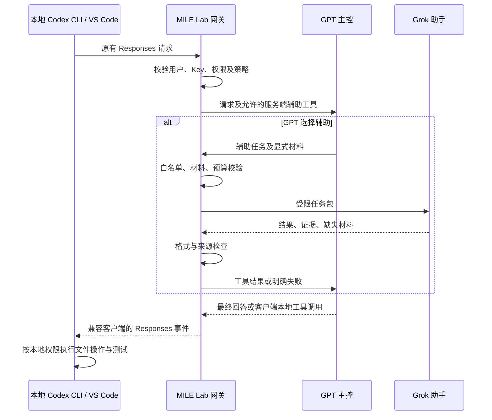

# MILE Lab 经济协作设计 v0.1

状态：供讨论的设计稿，尚未批准实施。2026-11-14。

## 1. 已确认的目标与设计选择

用户已确认：通过多模型分工减少成本，并在有收益时增强能力；Grok 更便宜不构成降低交付质量的理由。GPT 自身即可并行，因此并发数不作为本功能的价值指标。用户不应新增角色文件、MCP 或反复修改客户端配置；协作策略在网站管理。保持 Codex CLI、VS Code 及已有统一 Key 的使用方式。

以下为本稿提出的实现选择，尚未视为用户批准：GPT 保持主控，按任务白名单调用服务端 Grok 助手；首版只处理已提供的材料，输出分析或候选补丁，由本地 Codex 执行。先证明协议可行，再证明质量和总成本，最后做管理界面及灰度。

优化顺序：满足验收与权限约束 → 降低总成本 → 控制耗时 → 扩展能力。功能属于跨网关协议、计费和客户端兼容的中型项目，不能按“增加一个模型选项”的规模实施。

## 2. 第一版交付边界

首版任务白名单：有证据位置的日志提取与分类；有明确字段和来源的数据整理；已有代码与规范下的独立测试草稿或局部候选补丁。后两类涉及代码的结果必须经过本地验收，不能因为输出格式正确就直接采用。

以下继续由 GPT 主控：需求澄清、架构与依赖判断、复杂根因定位、跨模块修改、最终交付结论。鉴权、额度、计费、迁移、生产操作及包含敏感材料的任务不进入首版自动分流。此白名单限制协作任务，不限制用户原有的直接 Grok 调用。

首版不新增本地连接器、云端代码工作区、自动多模型投票或无限递归分工；不声称 Grok 能独立读取本地仓库、运行终端或拥有原生 Codex 子智能体的完整能力。不静默将 GPT 请求替换为 Grok。

用户入口建议只有“GPT 全程”和“经济协作”。额外交叉检查作为明确增加消耗的独立开关，初期关闭；不与降本收益混算。

## 3. 架构与控制责任

网站负责授权、开关、任务白名单、预算上限、用量和审计展示。GPT 决定一个允许的任务是否值得委派，并负责结果整合。网关强制执行可机械判断的限制；不能只依赖提示词。Grok 仅获得任务包，不获得用户 Key、母账号凭据、任意 URL 访问或服务器文件工具。

网关提供一个私有辅助工具；工具允许的操作和输入有固定结构，模型不能通过改变任务类型名称绕过限制。模型的难度判断和置信度不是权限或质量证据。网关不能可靠理解所有代码的业务风险，因此授权范围、允许的数据类型和 GPT 任务选择仍需共同约束。

辅助调用必须沿现有账号路由、用途权限、额度及持久计费流程执行，不能使用管理员共享 Key 代替实际用户。内部调度应使用受验证的用户/Key 身份，不把可伪造的 HTTP 字段作为身份，也不把辅助请求再次送入协作递归路径。

## 4. 协议可行性是实施前置门槛

拟采用服务端工具循环，参考 CCR Fusion 和 agents-as-tools。它是待验证的适配方案，目前没有证据证明可无损接入现有订阅 Responses 通道。

第一步只在隔离环境或显式管理员测试路径验证：GPT 能调用一个私有辅助工具，网关处理并将结果继续交给同一主模型；客户端仍能正确执行自己的工具调用。不能假设官方托管工具能力可直接用于当前订阅通道。

必须明确实现以下不变量：

- 私有工具调用和结果由网关消费，不能泄漏为客户端无法识别的本地工具调用；客户端原有工具及结果不得被误消费。
- 每个外部请求只有一组合法的 Responses 生命周期；内部 response ID、item ID、call ID 和 usage 不能直接拼接。需要会话映射和独立 usage 归集，客户端响应仍如实声明主模型。
- 多轮历史、压缩、`previous_response_id`（客户端使用时）、恢复及重发须验证。内部工具轨迹必须可在同一授权范围恢复，不能留下只有模型记得、网关丢失的半轮状态。
- 兼容原生加密 reasoning / agent 内容，保持原用途原样传递，不试图解密或交给 Grok。材料只有不透明载荷时应拒绝委派。
- 验证文本与工具混合输出、并行本地工具调用、错误事件、客户端中止、连接中断、限流及后续正常继续。不得声称 HTTP 通过即代表 WebSocket 通过；第一版沿用当前 HTTP Responses 范围。
- 明确何时可以向客户端发送事件。若为隐藏内部工具需要缓冲，则记录首字延迟和缓冲上限；不能先发出已完成事件，再追加内部模型循环。

若无法在当前协议上满足以上约束，本方案停留在实验状态，不强行上线。可另行评估用户一次性安装 MCP 或云端工作区，但这属于体验和范围变化，不能作为本方案零新增配置目标已达成的证明。

## 5. 分配规则与建议初始配置

| 项目 | 初始建议 | 强制执行位置 |
| --- | --- | --- |
| 开放范围 | 管理员先测试；普通用户需明确授权并主动开启 | 网站及真实调用入口 |
| 主模型 | 保持用户所选 GPT，首轮验证 gpt-6.1-sol | 网关 |
| 助手 | grok-4.7，按实际可用模型能力校验 | 网关 |
| 白名单 | 第 2 节任务类型 | 策略及任务入口 |
| 同时进行的助手调用 | 每个协作轮次最多 1 个 | 调度器 |
| 助手调用总数 | 每个协作轮次最多 2 次，允许一次补材料 | 调度器 |
| 新增 GPT 内部续接 | 每轮最多 2 次；同时设置累计输入/输出 Token 预算 | 调度器 |
| 自动重试 | 默认 0；业务失败直接返回主模型 | 调度器 |
| 每次超时 | 初始 30 秒，属于待测参数 | 调度器 |
| 辅助累计等待上限 | 每个协作轮次 45 秒，受客户端更短期限约束 | 调度器 |
| 递归委派 | 禁止 | 调度器 |
| 预算 | 分别设置 Grok 点数及新增 GPT 内部 Token 上限，未配置则不能调用 | 调用前预算检查 |
| 交叉审查 | 关闭 | 策略 |

这里的“协作轮次”指一次客户端外部 Responses 请求及其内部辅助循环，网关生成 `run_id`。用户的一整个自然语言任务可能跨多个请求；首版不声称能准确识别其完整边界。另设用户/Key 的持久日预算控制跨轮次累计消耗，不能依靠重连清空。

长任务是否值得委派应考虑材料长度、剩余上下文、可验收性及预计总开销。首版采用可解释规则，不额外花一次 GPT 调用对每个请求做难度分类。禁止“无论什么任务先问 Grok”。

## 6. 上下文交接契约

每次委派使用独立 `task_id`，绑定用户、Key、`run_id`、策略版本及输入内容哈希。任务包至少包含：目标、明确输出格式、必要背景、不可违反的约束、原始材料及来源引用、验收条件、尚不确定的问题、预算和截止时间。

代码材料按客户端提供的路径及内容哈希标记快照。路径是来源标签，不是让服务器自行打开文件的指令。哈希证明本次材料一致，不证明材料完整或仍是本地最新版本。没有可验证会话标识时不跨请求合并材料，禁止仅凭相同提示词或相同 Key 推测属于同一任务。

助手输出固定包含：`status`（ok / needs_context / failed）、结果、证据引用、假设、缺失材料、建议检查。候选补丁另带预期输入哈希与涉及路径。`needs_context` 由 GPT 决定是否读取本地材料；再调用助手仍受两次总数、总超时和预算约束。不允许助手以猜测补齐未知需求。

不向 Grok 转发完整父会话、加密内部内容、认证数据和无关文件。只发送用户已授权该功能处理的必要内容。提示词不是安全边界；对已识别凭据应阻止发送，无法识别全部秘密的限制应在开启时简短说明。

仓库文本、日志和助手结果均属于不可信输入，不能覆盖平台规则、扩展工具权限或授权生产操作。各用户、各 Key、各 `run_id` 的原始材料及缓存必须隔离；首版禁用跨用户语义缓存。

## 7. 验收与回退

验收分层：网关检查输出结构、大小、材料引用及是否缺上下文；GPT 检查结论是否回答任务并与证据一致；涉及代码的结果由本地 Codex 在原权限下执行针对性测试、类型或编译检查。网关不把助手声称“测试通过”作为实际测试证据。

日志结论必须引用实际存在的片段；输出代码必须满足原有独立测试及验收条件。助手新写的测试可以补充覆盖，不能作为自己生成的代码唯一正确性证明。文件已变化时重新检查候选补丁，禁止直接覆盖。

网关可确认的任务状态：created → running → needs_context / candidate_delivered / failed，任何非终态均可取消。交付候选结果不等于结果被采用，更不等于整个任务验收完成。

验收观测单列：`unknown`、`model_reported_acceptance`、`model_reported_rejection`、`verified_acceptance`、`verified_rejection`。GPT 的结构化回报只能属于 model_reported；普通客户端返回的工具输出也不是可独立信任的执行证明。只有受控评测运行器关联实际命令、快照、退出码和独立验收时，才记录 verified。没有足够关联证据就保持 unknown，不能推算采用率或返工率。

首版生产页面展示辅助是否交付、主模型是否报告采用及其证据等级。端到端质量、完整任务耗时与后续返工由受控评测统计；无客户端新增集成时，网站不能保证观察到用户的完整本地验收和后续返工。

超时、限流、格式失败、权限撤销、材料不足或验收不通过，都返回明确原因，让 GPT 继续处理。回退不能绕过 GPT 的额度或权限；GPT 已耗尽则报告现状，不能以“质量优先”免费继续。Grok 不可用或额度不足只停用辅助，不改变正常 GPT 请求的原规则。

已发起调用在取消、超时或失败后仍可能产生实际消耗；继续恢复和结算持久任务。不能承诺取消即免费。进程崩溃后，只有明确知道未发往上游的调用才可重新发送；未知状态记为待核对，不能凭内容相同擅自重发。内部幂等不能保证上游支持恰好一次执行。

## 8. 成本与收益的统计口径

先保留消耗向量：GPT 输入/输出/缓存 Token、Grok 对应 Token、Codex 点数、Grok 点数、所有重试和回退、墙钟耗时、验收结果。两种用途点数不能直接相加成一种成本。

平台可以另配置带版本与有效时间的成本权重，将各模型实际消耗折算为“估算资源成本”。无可靠货币成本时不标为实际人民币，不用 API 公价替代订阅的真实成本。一次任务的实际现金支出、订阅额度占用和长期容量成本是不同指标。

总成本包括：GPT 拆分与交接、Grok 执行、GPT 核对、失败重做、额外上下文及缓存损失。GPT 节省但 Grok 和回退开销更大时不能判定为降本。助手 usage 不能塞进 GPT Token 冒充单一模型；网页按实际模型分项展示。

“节省比例”只能来自同任务集的 GPT 全程对照，计算为 `(基线平均成本 - 协作平均成本) / 基线平均成本`。不为生产中没有对照的每次调用伪造“节省 30%”。点数仍 pending 或结算异常的样本单列，不能按 0 消耗记成功。

普通生产统计只对可观测 `run_id` 及关联调用归集费用；跨请求无法可靠关联的自然语言任务，不展示其完整总成本或端到端收益。受控运行器才能将所有后续 GPT 调用及返工计入同一评测任务。

## 9. 计费、预算与持久化约束

用户必须先拥有统一编程访问权，再拥有协作授权，并显式允许消耗 Grok 额度。撤销任一条件阻止新增辅助；已有实际消耗正常结算。直接调用 Grok 的权限不自动等于协作授权。

每次真实 GPT/Grok 上游调用沿现有账本与持久任务记录，关联父 `run_id` 和子 `task_id`；逻辑任务和尝试编号用于关联，不作为额外的一笔收费。主请求的聚合统计不能再把已经单独记账的助手重复扣一次。

用户/Key 协作预算是独立、显式授权的功能上限，不能改变 Codex/Grok 当前 shadow 观察状态或擅自启用 enforce。并发预算需原子预留；无可靠最坏消耗估算、输出上限或余额不足时拒绝新增辅助。已发送的请求可能超出预估，预算展示应说明估算和最终结算区别，不能承诺精确硬封顶。

首版预算分开约束两类增量：Grok 辅助点数的每轮与日上限；新增 GPT 内部续接的次数和累计输入/输出 Token 的每轮与日上限。后者包括重放上下文，不能只限制输出 Token。用户上限与 Key 上限同时生效；未建立可信成本权重时不提供混合货币硬预算。新增 GPT 调用仍扣 Codex 实际额度，原始正常 GPT 请求沿原有规则。

发起助手前，必须为返回结果后的 GPT 续接预留调用次数和 Token 空间；续接请求的输入大小及输出上限需可约束，否则不启动辅助。到达上限时移除辅助工具并结束辅助循环，不能留下悬空工具调用或非法响应。Token 估计和点数折算误差须展示，最终以实际结算为准。

新增协作审计概念：策略快照、调用关联、状态变化、验收与回退原因、预算预留。实施时再依 PostgreSQL 规范设计追加式迁移；本稿不规定数据库表或执行 SQL。重启不能清空预算或待结算任务。保留现有原账本、各类重置/容量/纠正事件、钱包起点、预留和计费任务；不恢复旧数据库覆盖新消耗。

默认审计保存模型、哈希、大小、状态、时间、策略及实际消耗，原始代码和日志不进入普通访问日志。恢复必需的最小工具轨迹应加密、按用户和 Key 隔离；建议受限保留 24 小时后删除敏感正文，保留非正文审计和账本。超过保留期的内部续接明确失败并让 GPT 从客户端重新提供的可见材料继续，不无声猜测恢复。不得删除仍须结算的最小业务数据；普通用户只能查看自己的记录。

## 10. 网站行为与兼容性

管理员可给指定用户授权、配置白名单和功能预算、检查调用失败与回退、立即关闭新增辅助。测试用户在统一编程页面明确开启协作并选择不超过管理员上限的预算；模型和 Key 入口复用现有体系，不自动迁移旧 Key。

默认按 Key 开启；每个新外部请求固定策略版本。管理员的安全关闭、用户撤销及权限变化立即阻止尚未发起的辅助，其余策略变化对后续外部请求生效。当前辅助响应可返回，但无权继续下一次调用。

若客户端无可靠稳定会话标识，首版只承诺每个外部请求的策略固定；页面明确写“对后续请求生效”，不能承诺整段聊天固定。CLI 与 VS Code 的会话识别支持分别验证，不从其他客户端通过推断。

正常用户关闭协作时保持现有转发路径；协作故障时可关闭工具注入，恢复 GPT 全程路径。只回退程序/功能开关，不回滚账本。旧 `auth.json`、配置、Provider ID 和本地历史不改写。

## 11. 验证、试验与开放门槛

阶段 A：协议验证。真实官方 CLI 和 VS Code 各验证一次完整辅助闭环、原有工具、恢复、取消、错误和计费。未通过第 4 节的会话一致性要求时停止，不制作“已兼容”界面。

阶段 B：离线对照。使用授权测试材料，GPT 全程与经济协作运行同一任务、同一代码快照和相同验收规则，隔离工作区；固定模型、策略、命令和环境，轮换执行顺序并记录缓存影响。每种候选任务至少 30 个样本、含正常/边界/失败场景，仅作为试点样本，不足以证明长期质量等价。测试成本明确归测试预算，不对普通用户暗中双跑。

质量门槛优先：共同独立验收通过，不能出现权限越界、数据泄漏、账本错扣等严重错误；人工检查难以自动判定的结果，避免只有自评。小样本未发现差异只能进入有限试点；扩大开放前预先确定可接受退化界限和所需样本，不能事后挑指标宣称质量不降。

建议经济门槛：某类任务最终结算后的平均估算总成本至少下降 10%，同时分别展示 GPT/Grok 点数变化。若没有可信成本权重，只报告消耗变化，不判定总体降本。建议体验门槛：相对基线中位耗时增加不超过 20%、p95 增加不超过 25%。这些数字是待校准的设计建议，非现有实测结论。

阶段 C：管理员在线试点，接着明确邀请少量用户。按任务类别统计可观测的交付率、补材料率、网关失败/回退、结算完整性和辅助耗时；模型报告采用率单列。直接采用率、完整 GPT 回退、端到端验收失败与返工等只有受控运行器拥有可靠关联时才统计，否则标为 unknown。不默认将通过一类任务的结果推广到全部任务；新增类别重新评估。

任一权限/隔离/计费严重异常立即关闭新增辅助并调查。质量退化或成本无收益的类别回退 GPT；小样本高延迟和回退告警由管理员检查，不让自动路由在短时间内来回振荡。全面开放必须管理员手动决定，升级和重启不能自动扩大名单。

实际实现影响公共网关、鉴权和计费，测试范围须覆盖受影响 Go 包并扩大公共路径回归；涉及额度及应用发布仍执行真实隔离 PostgreSQL `TestCodingQuotaDB -race`，不能把 DSN 缺失 skip 当通过。UI 实现执行完整前端验证及真实用户路径，使用现有 delivery 工具复用产物；本轮仅设计文档不触发应用构建和部署。

## 12. 开源复用与实现顺序

| 参考 | 采用什么 | 不直接假定什么 |
| --- | --- | --- |
| [PAL MCP](https://github.com/BeehiveInnovations/pal-mcp-server)，Apache-2.0 | 显式上下文、工具化协作、续接及审查流程 | MCP 部署后原生 Codex 自动发现；所有历史天然完整 |
| [Claude Code Router](https://github.com/musistudio/claude-code-router)，MIT | Fusion 服务端工具循环与协议适配思路 | 本地启动器可由远程网站替代；订阅协议已全面通过 |
| [OpenAI 多智能体文档](https://developers.openai.com/codex/multi-agent) | 区分原生客户端子智能体和本方案 | 服务端工具等于原生 explorer/worker |
| [Deep Agents](https://github.com/langchain-ai/deepagents)，MIT | 后续云端工作区的候选运行时 | 首版必须引入完整运行时 |

第一步是隔离协议实验；第二步是单一白名单助手加完整关联计费与验收；第三步做对照基准；第四步才把已有实验能力接入网站授权、预算及审计；最后进行有限用户试点。避免同时重构现有 Go 网关、引入第二套账本和搭建完整 Agent 平台。

是否抽取少量代码、通过内部侧车复用，或在现有 Go 路径实现，留给协议实验后的技术选择。引入依赖前固定 SHA、核对协议和许可证；不能只因 README 声称支持 Codex 就直接上线。

## 13. 现有证据与本稿产物

本地试验记录：[混合模型子智能体试验](../../engineering-upgrade/MIXED-AGENT-2026-11-14.md)。直接原生委派因不透明消息未通过；固定任务文件的小任务闭环通过，但未证明降本、速度或 VS Code 广泛兼容。

已有统一编程、权限与客户端接入继续复用；本稿不改线上服务、数据库、配置或开放名单。全部建议初值、预算口径及协议实现都属于待实施设计，不是已经上线的能力。

文档页面：类型 document，ID `economic-agent-collaboration`，路径 `.ryugi/artifacts/document/economic-agent-collaboration/doc.xml`；它展示本稿的决策摘要、架构与阶段门槛。以此 Markdown 为完整设计记录；讨论中若修改决定，先同步正文，避免浏览器摘要与实施说明不一致。

独立 builder check 已指出并补充两处设计缺口：生产网关无法独立确认本地验收，故拆分观测证据等级；Grok 预算不足以限制协作增加的 GPT 消耗，故补充独立 GPT 内部续接和 Token 预算。以上审查只检查设计完整性，不代表协议或收益已验证。
